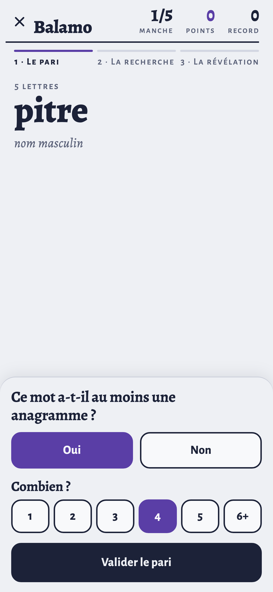
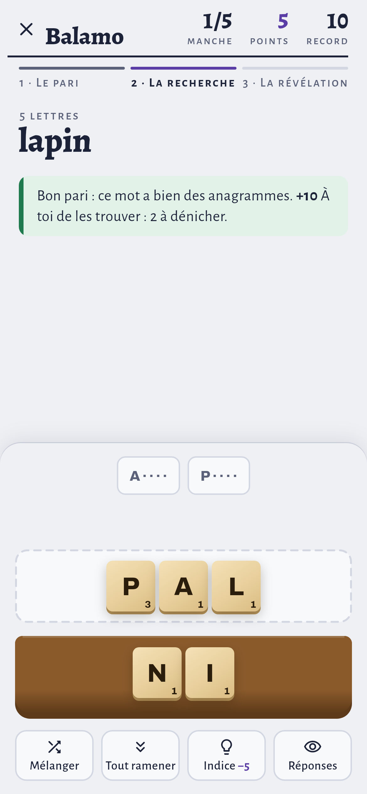
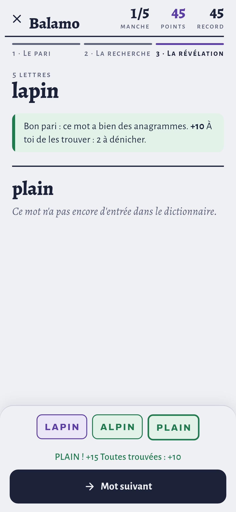
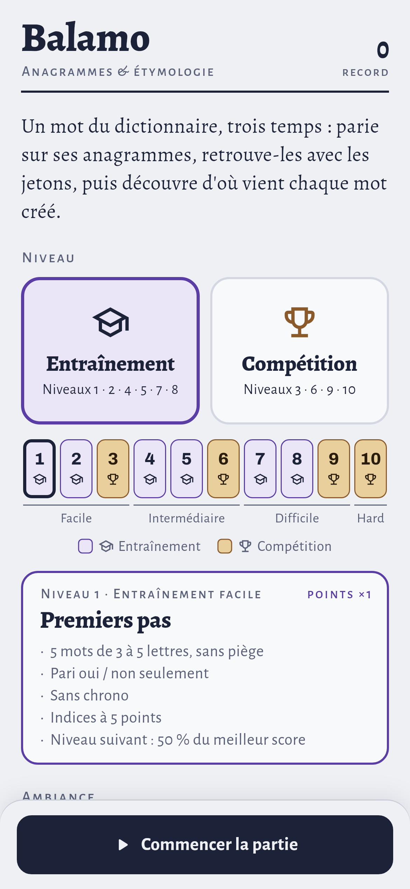
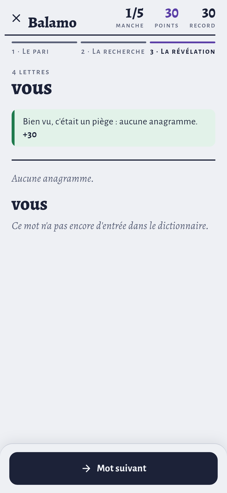
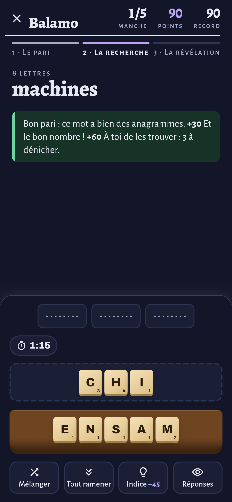
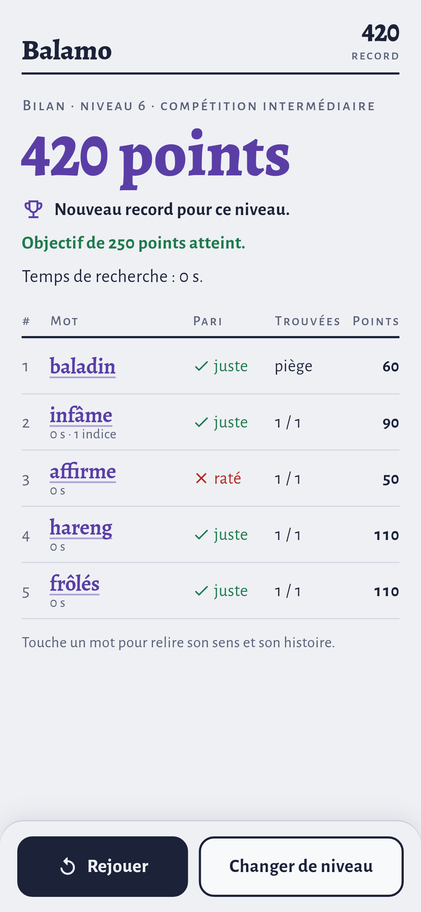

# Balamo

**Le jeu où chaque mot en cache un autre.**

*Parier, chercher, découvrir : des anagrammes, et l'histoire des mots qui va avec.*

## En bref

| | |
| --- | --- |
| **Genre** | Jeu de lettres : anagrammes et étymologie |
| **Plateformes** | Android (7.0 et plus) ; iOS prévu |
| **Langue** | Français |
| **Durée d'une partie** | 5 mots, soit quelques minutes |
| **Joueurs** | 1 |
| **Connexion** | Aucune : le jeu fonctionne hors ligne, sans compte et sans publicité |
| **Contenu** | Environ 69 000 mots à jouer, répartis sur 10 niveaux ; définitions et histoires pour une petite partie d'entre eux à ce jour |
| **Version** | 1.0.1, en phase de test (Android, publication sur le Play Store en cours) |

## Le principe

Un mot du dictionnaire s'affiche. A-t-il une anagramme ? Deux ? Aucune ? Avant de toucher la moindre lettre, il faut parier. Et attention : certains mots sont des pièges, ils n'en ont aucune.

Vient ensuite la recherche. Les lettres attendent sur le chevalet, sous forme de jetons de bois. On les fait glisser sur le plateau, on les mélange, on recommence, jusqu'à voir apparaître le mot caché.

Chaque mot trouvé livre alors son sens et son histoire : d'où il vient, par quelles langues il est passé, ce qu'il voulait dire autrefois. On vient pour le jeu de lettres, on repart avec l'étymologie.

## Une manche en trois temps

| 1 · Le pari | 2 · La recherche | 3 · La révélation |
| --- | --- | --- |
|  |  |  |
| Ce mot a-t-il une anagramme ? Et combien ? | Déplacer les jetons du chevalet vers le plateau pour former les mots cachés. | Le sens et l'histoire de chaque mot trouvé. |

## Dix niveaux

Deux catégories : l'entraînement (niveaux 1, 2, 4, 5, 7 et 8) et la compétition chronométrée (3, 6, 9 et 10).

| Niveau | Catégorie | Lettres | Pièges sur 5 | Pari | Indices par mot, prix | Chrono | Points |
| --- | --- | --- | --- | --- | --- | --- | --- |
| 1 Premiers pas | Entraînement facile | 3 à 5 | 0 | Oui / non | lettres − 1, 5 | – | × 1 |
| 2 Premiers pièges | Entraînement facile | 3 à 5 | 1 | Oui / non | lettres − 1, 5 | – | × 1 |
| 3 Championship I | Compétition facile | 3 à 5 | 1 | Oui / non | lettres − 1, 5 | 90 s | × 1 |
| 4 Combien ? | Entraînement intermédiaire | 5 à 6 | 1 | + combien | 3, 10 | – | × 2 |
| 5 L'indice se paie | Entraînement intermédiaire | 5 à 7 | 1 | + combien | 3, 20 | – | × 2 |
| 6 Championship II | Compétition intermédiaire | 5 à 7 | 1 | + combien | 3, 20 | 90 s | × 2 |
| 7 Grand format | Entraînement difficile | 5 à 8 | 1 | + combien | 2, 45 | – | × 3 |
| 8 Très grand format | Entraînement difficile | 5 à 10 | 2 | + combien | 2, 45 | – | × 3 |
| 9 Championship III | Compétition difficile | 5 à 10 | 2 | + combien | 2, 45 | 75 s | × 3 |
| 10 Battle royale extrême | Compétition hard | 8 à 11 | 2 | + combien | 1, 100 | 60 s | × 5 |

Une partie compte 5 mots. Atteindre 50 % du meilleur score possible sans indice (60 % aux niveaux 9 et 10) débloque le niveau suivant. En compétition, le temps de recherche de chaque mot est mesuré et affiché au bilan.

## Le score

| Action | Points de base |
| --- | --- |
| Bon pari oui / non | +10 |
| Bon « non » sur un mot piège | +30 |
| Bon nombre d'anagrammes | +20 |
| Chaque anagramme trouvée | +15 |
| Toutes les anagrammes trouvées | +10 |

Les points sont multipliés selon le niveau. Un indice dévoile une lettre mais se paie tout de suite (de 5 à 100 points selon le niveau) : il faut avoir assez de points pour se l'offrir.

## Les points forts

- **Un jeu de lettres qui apprend quelque chose** : chaque mot trouvé raconte son origine.
- **Le pari avant la recherche** : une part de flair et de risque, pas seulement de la manipulation de lettres.
- **Des mots pièges** qui obligent à réfléchir avant de répondre « oui ».
- **Des parties courtes**, pensées pour le téléphone et pour une main : jetons à toucher ou à glisser, boutons sous le pouce.
- **Un record à battre** pour chaque niveau.
- **Une ambiance calme** : papier, encre et bois, sons de marimba, musique douce, thème clair ou sombre. Sons et musique se coupent séparément.

## Quelques écrans

| Accueil | Mot piège | Compétition, thème sombre | Bilan |
| --- | --- | --- | --- |
|  |  |  |  |

## Fiche technique

| | |
| --- | --- |
| **Technologie** | Flutter (Dart), interface Material 3, un seul code pour Android et iOS |
| **Android** | 7.0 (API 24) au minimum |
| **Taille de l'APK** | Environ 53 Mo |
| **Orientation** | Portrait |
| **Données** | Mots, définitions et étymologies embarqués dans l'application |
| **Sauvegarde** | Records et réglages conservés sur l'appareil |
| **Polices** | Alegreya, Alegreya Sans, Alegreya Sans SC, Archivo (licence SIL Open Font) |

Pour installer, compiler ou modifier le jeu, voir le [README](README.md) et les guides du dossier [`docs/`](docs/).
