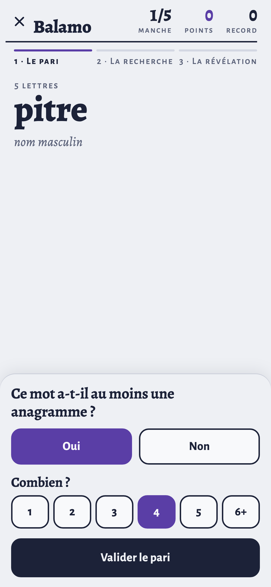

# Balamo

Jeu mobile d'anagrammes et d'étymologie, écrit en Flutter (Android d'abord, iOS ensuite).

Un mot du dictionnaire, trois temps :

1. **Le pari** — ce mot a-t-il au moins une anagramme ? (Et combien, aux niveaux supérieurs.)
2. **La recherche** — retrouve-les en déplaçant les jetons du chevalet vers le plateau.
3. **La révélation** — le sens et l'histoire de chaque mot trouvé.

| Accueil | Pari | Recherche | Révélation |
| --- | --- | --- | --- |
|  |  |  |  |

## Démarrer

```bash
flutter pub get
```

```bash
flutter run
```

```bash
flutter build apk --release
```

L'APK se trouve ensuite dans `build/app/outputs/flutter-apk/app-release.apk`.

## Documentation

| Guide | Contenu |
| --- | --- |
| [01 · Installation](docs/01-installation.md) | Flutter, JDK, SDK Android, variables d'environnement, `flutter doctor` |
| [02 · Développement et test](docs/02-developpement-et-test.md) | Lancer sur téléphone ou émulateur, Hot Reload, tests |
| [03 · Compiler l'APK](docs/03-build-apk.md) | APK de test et de production, installation, signature |
| [04 · Architecture](docs/04-architecture.md) | Organisation de `lib/`, où modifier les règles ou l'interface |

## Règles en bref

Barème de base, multiplié par 1 en facile, 2 en intermédiaire, 3 en expert :

| Action | Points |
| --- | --- |
| Bon pari oui / non | +10 |
| Bon « non » sur un mot piège | +30 |
| Bon nombre d'anagrammes (intermédiaire, expert) | +20 |
| Chaque anagramme trouvée | +15 |
| Toutes trouvées | +10 |
| Chaque indice demandé (facile) | −5 |

Toutes ces valeurs se règlent dans [`lib/logic/regles.dart`](lib/logic/regles.dart) et [`lib/models/niveau.dart`](lib/models/niveau.dart).

## Sons

Chaque action a son bruitage (jeton posé ou repris, mélange, indice, mot trouvé ou refusé, chrono…) et une musique d'ambiance tourne en fond. Tout est synthétisé par [`tool/generer_sons.py`](tool/generer_sons.py) ; les interrupteurs **Sons** et **Musique** sont sur l'accueil. Détails dans [04 · Architecture](docs/04-architecture.md).

## Crédits

Polices Alegreya, Alegreya Sans, Alegreya Sans SC (Huerta Tipográfica) et Archivo (Omnibus-Type), sous licence SIL Open Font License — textes dans `assets/fonts/OFL-*.txt`.
