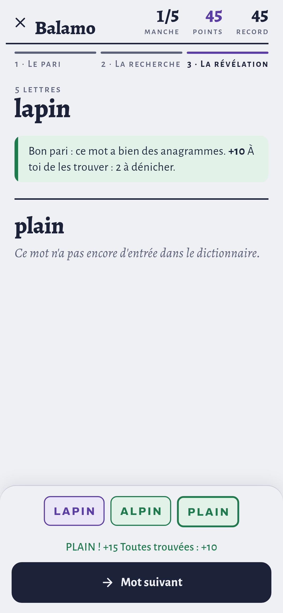

# Balamo

Jeu mobile d'anagrammes et d'étymologie, écrit en Flutter (Android d'abord, iOS ensuite).

Un mot du dictionnaire, trois temps :

1. **Le pari** — ce mot a-t-il au moins une anagramme ? (Et combien, aux niveaux supérieurs.)
2. **La recherche** — retrouve-les en déplaçant les jetons du chevalet vers le plateau.
3. **La révélation** — le sens et l'histoire de chaque mot trouvé.

| Accueil | Pari | Recherche | Révélation |
| --- | --- | --- | --- |
|  |  |  |  |

## Démarrer

```bash
flutter pub get
```

```bash
flutter run
```

```bash
flutter build apk --release
```

L'APK se trouve ensuite dans `build/app/outputs/flutter-apk/app-release.apk`.

## Versions

L'historique est dans [`CHANGELOG.md`](CHANGELOG.md).

**À chaque nouvelle version, avant de compiler :**

1. Dans [`pubspec.yaml`](pubspec.yaml), augmenter le code de version (le `+N` de `version:`) et, si besoin, changer le nom de version.
2. Dans [`CHANGELOG.md`](CHANGELOG.md), ajouter la version (nom, code, changements) et mettre à jour le tableau des états du Play Store.
3. Reporter le nouveau numéro dans [`deploy-instruction.md`](deploy-instruction.md) et, si le nom change, dans [`PRESENTATION.md`](PRESENTATION.md).

## Documentation

| Guide | Contenu |
| --- | --- |
| [01 · Installation](docs/01-installation.md) | Flutter, JDK, SDK Android, variables d'environnement, `flutter doctor` |
| [02 · Développement et test](docs/02-developpement-et-test.md) | Lancer sur téléphone ou émulateur, Hot Reload, tests |
| [03 · Compiler l'APK](docs/03-build-apk.md) | APK de test et de production, installation, signature |
| [04 · Architecture](docs/04-architecture.md) | Organisation de `lib/`, où modifier les règles ou l'interface |

## Règles en bref

| Niveau | Catégorie | Lettres | Pièges sur 5 | Pari | Indices par mot, prix | Chrono | Points |
| --- | --- | --- | --- | --- | --- | --- | --- |
| 1 Premiers pas | Entraînement facile | 3 à 5 | 0 | Oui / non | lettres − 1, 5 | – | × 1 |
| 2 Premiers pièges | Entraînement facile | 3 à 5 | 1 | Oui / non | lettres − 1, 5 | – | × 1 |
| 3 Championship I | Compétition facile | 3 à 5 | 1 | Oui / non | lettres − 1, 5 | 90 s | × 1 |
| 4 Combien ? | Entraînement intermédiaire | 5 à 6 | 1 | + combien | 3, 10 | – | × 2 |
| 5 L'indice se paie | Entraînement intermédiaire | 5 à 7 | 1 | + combien | 3, 20 | – | × 2 |
| 6 Championship II | Compétition intermédiaire | 5 à 7 | 1 | + combien | 3, 20 | 90 s | × 2 |
| 7 Grand format | Entraînement difficile | 5 à 8 | 1 | + combien | 2, 45 | – | × 3 |
| 8 Très grand format | Entraînement difficile | 5 à 10 | 2 | + combien | 2, 45 | – | × 3 |
| 9 Championship III | Compétition difficile | 5 à 10 | 2 | + combien | 2, 45 | 75 s | × 3 |
| 10 Battle royale extrême | Compétition hard | 8 à 11 | 2 | + combien | 1, 100 | 60 s | × 5 |

Une partie compte 5 mots. Atteindre 50 % du meilleur score possible sans indice (60 % aux niveaux 9 et 10) débloque le niveau suivant. En compétition, le temps de recherche de chaque mot est mesuré et affiché au bilan.

Barème de base, multiplié selon le niveau :

| Action | Points |
| --- | --- |
| Bon pari oui / non | +10 |
| Bon « non » sur un mot piège | +30 |
| Bon nombre d'anagrammes (dès le niveau 4) | +20 |
| Chaque anagramme trouvée | +15 |
| Toutes trouvées | +10 |

Les niveaux se règlent dans [`lib/models/niveau.dart`](lib/models/niveau.dart), le barème dans [`lib/logic/regles.dart`](lib/logic/regles.dart).

## Mots des niveaux

Les mots viennent des CSV « base de production C1 à C5 » (`docs/informations/C1-C5-words/`). Chaque mot est proposé à tous les niveaux qui l'admettent : longueur, degré et nombre d'anagrammes (réglés dans `lib/models/niveau.dart`). Sont écartés les séries avec bonus, les mots sensibles et les lignes au statut « Rejeté ». Après avoir modifié les CSV ou ces critères :

```bash
dart run tool/importer_mastergrid.dart
```

```bash
flutter test
```

## Sons

Chaque action a son bruitage (jeton posé ou repris, mélange, indice, mot trouvé ou refusé, chrono…) et une musique d'ambiance tourne en fond. Tout est synthétisé par [`tool/generer_sons.py`](tool/generer_sons.py) ; les interrupteurs **Sons** et **Musique** sont sur l'accueil. Détails dans [04 · Architecture](docs/04-architecture.md).

## Crédits

Polices Alegreya, Alegreya Sans, Alegreya Sans SC (Huerta Tipográfica) et Archivo (Omnibus-Type), sous licence SIL Open Font License — textes dans `assets/fonts/OFL-*.txt`.
