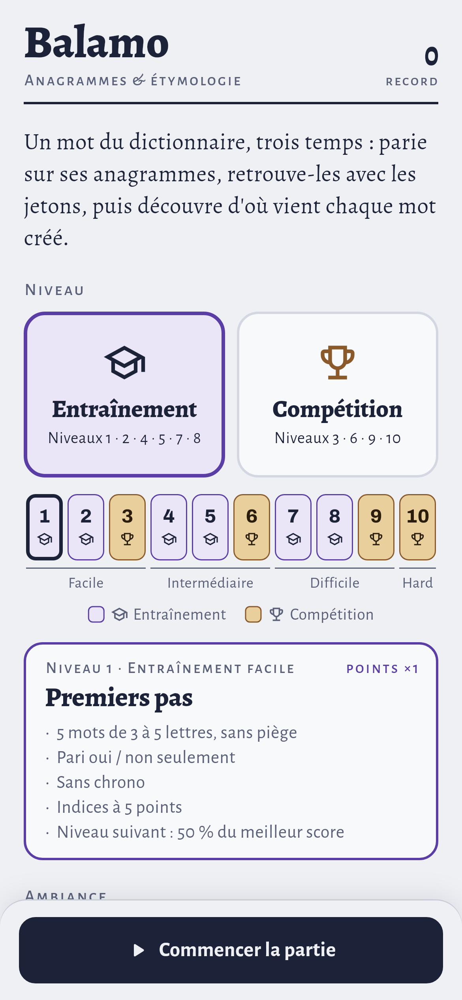
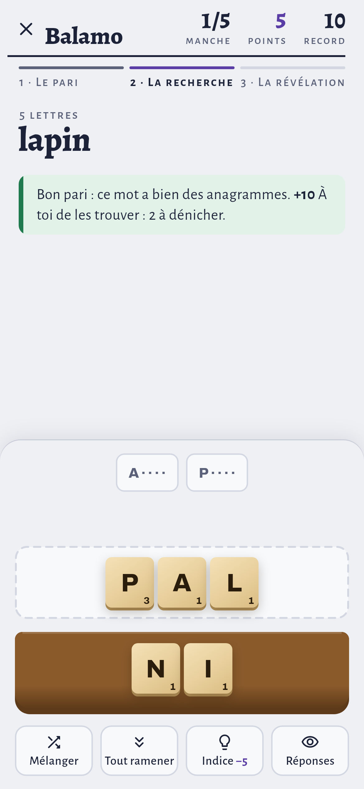

# Balamo

Jeu mobile d'anagrammes et d'étymologie, écrit en Flutter (Android d'abord, iOS ensuite).

Un mot du dictionnaire, trois temps :

1. **Le pari** — ce mot a-t-il au moins une anagramme ? (Et combien, aux niveaux supérieurs.)
2. **La recherche** — retrouve-les en déplaçant les jetons du chevalet vers le plateau.
3. **La révélation** — le sens et l'histoire de chaque mot trouvé.

| Accueil | Pari | Recherche | Révélation |
| --- | --- | --- | --- |
|  |  |  |  |

## Démarrer

```bash
flutter pub get
```

```bash
flutter run
```

```bash
flutter build apk --release
```

L'APK se trouve ensuite dans `build/app/outputs/flutter-apk/app-release.apk`.

## Versions

L'historique est dans [`CHANGELOG.md`](CHANGELOG.md).

**À chaque nouvelle version, avant de compiler :**

1. Dans [`pubspec.yaml`](pubspec.yaml), augmenter le code de version (le `+N` de `version:`) et, si besoin, changer le nom de version.
2. Dans [`CHANGELOG.md`](CHANGELOG.md), ajouter la version (nom, code, changements) et mettre à jour le tableau des états du Play Store.
3. Reporter le nouveau numéro dans [`deploy-instruction.md`](deploy-instruction.md) et, si le nom change, dans [`PRESENTATION.md`](PRESENTATION.md).

## Documentation

| Guide | Contenu |
| --- | --- |
| [01 · Installation](docs/01-installation.md) | Flutter, JDK, SDK Android, variables d'environnement, `flutter doctor` |
| [02 · Développement et test](docs/02-developpement-et-test.md) | Lancer sur téléphone ou émulateur, Hot Reload, tests |
| [03 · Compiler l'APK](docs/03-build-apk.md) | APK de test et de production, installation, signature |
| [04 · Architecture](docs/04-architecture.md) | Organisation de `lib/`, où modifier les règles ou l'interface |

## Règles en bref

| Niveau | Catégorie | Lettres | Pièges sur 5 | Pari | Indices par mot, prix | Chrono | Points |
| --- | --- | --- | --- | --- | --- | --- | --- |
| 1 Premiers pas | Entraînement facile | 3 à 5 | 0 | Oui / non | lettres − 1, 5 | – | × 1 |
| 2 Premiers pièges | Entraînement facile | 3 à 5 | 1 | Oui / non | lettres − 1, 5 | – | × 1 |
| 3 Championship I | Compétition facile | 3 à 5 | 1 | Oui / non | lettres − 1, 5 | 90 s | × 1 |
| 4 Combien ? | Entraînement intermédiaire | 5 à 6 | 1 | + combien | 3, 10 | – | × 2 |
| 5 L'indice se paie | Entraînement intermédiaire | 5 à 7 | 1 | + combien | 3, 20 | – | × 2 |
| 6 Championship II | Compétition intermédiaire | 5 à 7 | 1 | + combien | 3, 20 | 90 s | × 2 |
| 7 Grand format | Entraînement difficile | 5 à 8 | 1 | + combien | 2, 45 | – | × 3 |
| 8 Très grand format | Entraînement difficile | 5 à 10 | 2 | + combien | 2, 45 | – | × 3 |
| 9 Championship III | Compétition difficile | 5 à 10 | 2 | + combien | 2, 45 | 75 s | × 3 |
| 10 Battle royale extrême | Compétition hard | 8 à 11 | 2 | + combien | 1, 100 | 60 s | × 5 |

Une partie compte 5 mots. Atteindre 50 % du meilleur score possible sans indice (60 % aux niveaux 9 et 10) débloque le niveau suivant. En compétition, le temps de recherche de chaque mot est mesuré et affiché au bilan.

Barème de base, multiplié selon le niveau :

| Action | Points |
| --- | --- |
| Bon pari oui / non | +10 |
| Bon « non » sur un mot piège | +30 |
| Bon nombre d'anagrammes (dès le niveau 4) | +20 |
| Chaque anagramme trouvée | +15 |
| Toutes trouvées | +10 |

Les niveaux se règlent dans [`lib/models/niveau.dart`](lib/models/niveau.dart), le barème dans [`lib/logic/regles.dart`](lib/logic/regles.dart).

## Mots des niveaux

Les mots viennent des CSV « base de production C1 à C5 » (`docs/informations/C1-C5-words/`). Chaque mot est proposé à tous les niveaux qui l'admettent : longueur, degré et nombre d'anagrammes (réglés dans `lib/models/niveau.dart`). Sont écartés les séries avec bonus, les mots sensibles et les lignes au statut « Rejeté ». Après avoir modifié les CSV ou ces critères :

```bash
dart run tool/importer_mastergrid.dart
```

```bash
flutter test
```

## Définitions et étymologies

Les mots sans définition ou sans étymologie sont listés dans [`docs/tasks/mots-sans-definition.csv`](docs/tasks/mots-sans-definition.csv). On le remplit, puis on l'importe dans le jeu. La consigne à donner à une IA est dans [le mode d'emploi](docs/tasks/LISEZMOI.md).

### Avertissements

> - **CSV uniquement.** Les fichiers `.xlsx`, `.ods` ou autres ne sont pas lus.
> - **Séparateur : la barre verticale `|`.** Ni virgule, ni point-virgule, ni tabulation, ni barre oblique `/`.
> - **Encodage : UTF-8**, sinon les accents sont abîmés ou le fichier est illisible.
> - **Aucun guillemet autour des colonnes.** Un guillemet ajouté par un tableur serait affiché tel quel dans le jeu.
> - **Garder tous les textes dans le CSV.** `assets/donnees/definitions.json` est entièrement refait à chaque import : importer un lot partiel ou un fichier vierge efface les textes importés auparavant. Ne pas modifier ce fichier à la main.
> - **Une ligne refusée n'est pas importée**, même si elle l'avait été auparavant. La corriger et relancer l'import avant de commiter.
> - **Excel :** « Enregistrer sous > CSV » ne garde pas forcément la barre verticale. Vérifier le fichier avant de l'importer.
> - **Relire les textes**, surtout ceux produits par une IA : une étymologie peut être inventée.

### Format

```text
id|mot|categorie|definition|etymologie
CAVE|cave|C1|Pièce en sous-sol, où l'on garde le vin.|Du latin « cava », « creux ».
```

| Colonne | Contenu | À modifier ? |
| --- | --- | --- |
| `id` | Le mot en capitales sans accents ; clé utilisée par le jeu | Non |
| `mot` | Le mot accentué | Non |
| `categorie` | `C1` (courant) à `C5` (très rare) : degré de la série dans laquelle le mot est joué | Non |
| `definition` | Texte de la définition (peut rester vide) | Oui |
| `etymologie` | Texte de l'étymologie (peut rester vide) | Oui |

- La première ligne doit rester exactement `id|mot|categorie|definition|etymologie`.
- Chaque ligne a **5 colonnes**, donc **4 barres `|`**.
- Dans les textes, virgules, points-virgules, apostrophes, guillemets et parenthèses sont libres. La barre `|` et le retour à la ligne sont interdits.

### Importer

Depuis la racine du projet (sur le VPS, lancer d'abord `source ~/development/env.sh`) :

1. Importer le CSV :

   ```bash
   dart run tool/importer_definitions.dart
   ```

   Pour un fichier placé ailleurs (il doit contenir **tous** les textes à garder) :

   ```bash
   dart run tool/importer_definitions.dart chemin/vers/fichier.csv
   ```

2. Lire le résultat affiché (voir ci-dessous) et corriger les lignes refusées.

3. Vérifier le projet :

   ```bash
   flutter analyze
   ```

   ```bash
   flutter test
   ```

4. Relancer `flutter run` ou recompiler l'application : un rechargement à chaud ne suffit pas.

5. Commiter ensemble le CSV et `assets/donnees/definitions.json`. Pour diffuser les textes, suivre la section [Versions](#versions).

### Résultat de l'import

L'outil affiche le nombre de mots complétés, les lignes refusées avec leur numéro (les 20 premières en détail) et les mots encore incomplets par catégorie.

| Message | Cause | Effet |
| --- | --- | --- |
| `Fichier introuvable` | Mauvais chemin | Rien n'est modifié |
| `la première ligne doit être « … »` | En-tête ou séparateur incorrect | Rien n'est modifié |
| `… colonnes au lieu de 5` | Une barre `|` en trop ou en moins, ou un texte coupé sur deux lignes | Ligne refusée |
| `id « … » inconnu dans le jeu` | `id` modifié | Ligne refusée |
| `doit avoir le mot « … » et la catégorie …` | `mot` ou `categorie` modifié | Ligne refusée |
| `id « … » en double` | Même `id` sur deux lignes | Seule la première est gardée |

Les lignes valides sont importées même si d'autres sont refusées.

### Dans le jeu

- Seules les lignes qui ont une définition ou une étymologie sont importées : on peut remplir le fichier petit à petit.
- Le dictionnaire existant (`assets/donnees/balamo.json`) reste prioritaire : le CSV ne remplit que ce qui lui manque.
- Une définition importée porte la mention « définition à relire ».

## Sons

Chaque action a son bruitage (jeton posé ou repris, mélange, indice, mot trouvé ou refusé, chrono…) et une musique d'ambiance tourne en fond. Tout est synthétisé par [`tool/generer_sons.py`](tool/generer_sons.py) ; les interrupteurs **Sons** et **Musique** sont sur l'accueil. Détails dans [04 · Architecture](docs/04-architecture.md).

## Crédits

Polices Alegreya, Alegreya Sans, Alegreya Sans SC (Huerta Tipográfica) et Archivo (Omnibus-Type), sous licence SIL Open Font License — textes dans `assets/fonts/OFL-*.txt`.
